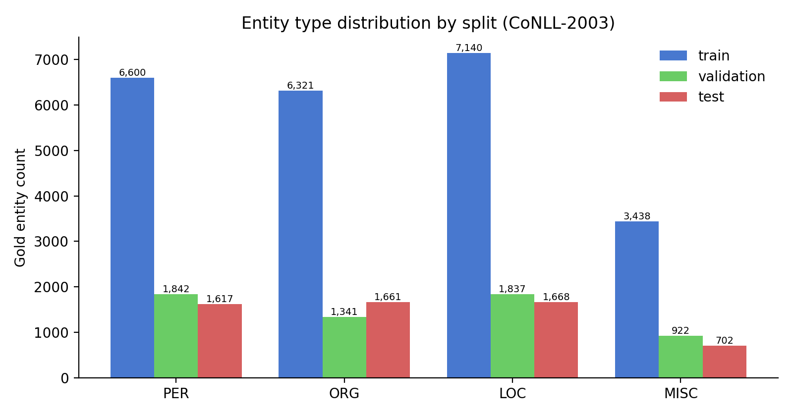
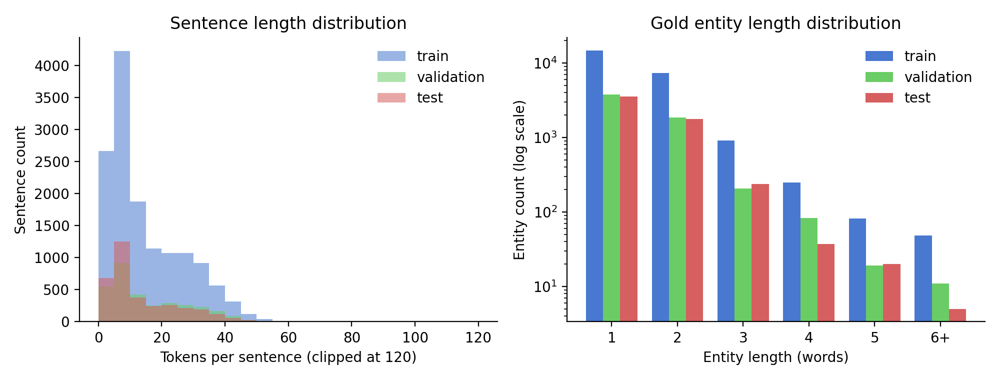
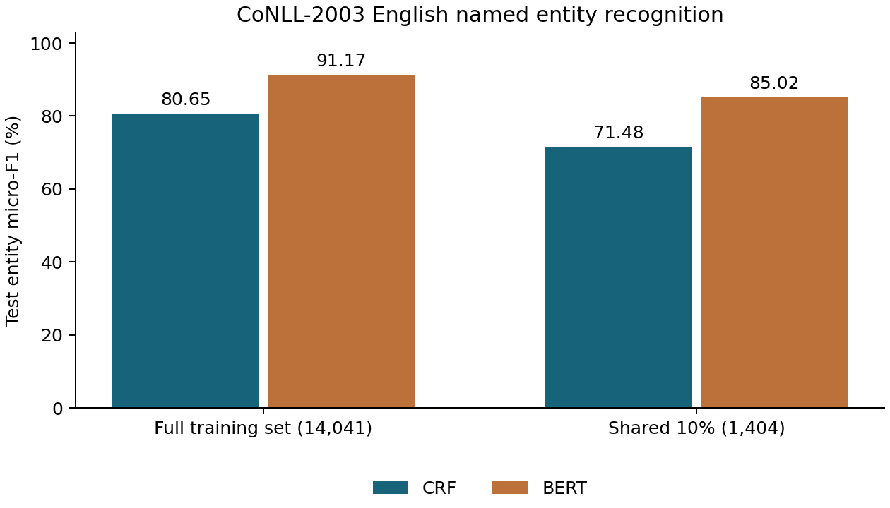
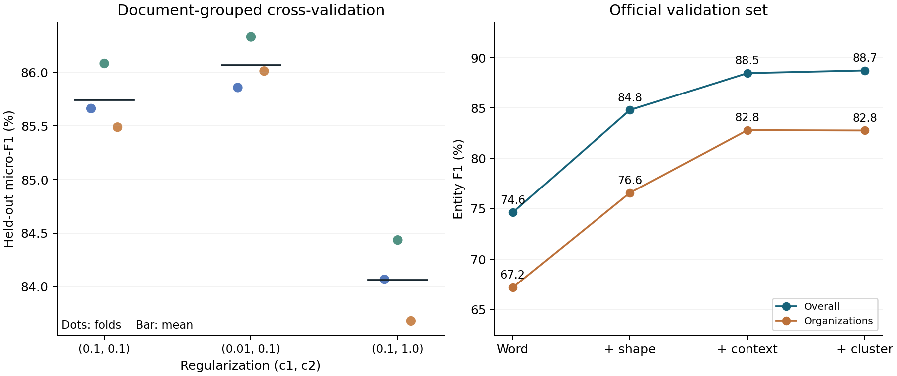
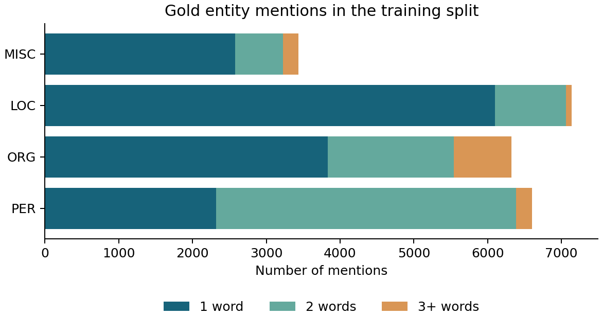
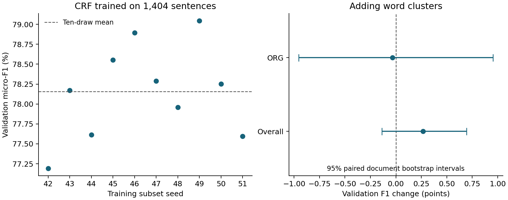

# English Named Entity Recognition: Comparing CRF and BERT under Different Training Data Budgets

> 报告整合初稿（A 合稿）。章节标注了负责人：
> [A] = 已定稿待复核；[B]/[C] = 从 B/C 交付物料凝练，待本人确认；
> 数字均经 A 的统一评估器独立复算（与 B/C 各自报告一致）。

---

## Abstract　[A]

We compare two approaches to English named entity recognition (NER) on CoNLL-2003: a linear-chain conditional random field (CRF) with handcrafted features, and a fine-tuned `bert-base-cased` word-classification model. Both systems are evaluated under two training-data budgets: the full 14,041-sentence training set and a fixed 10% subset of 1,404 sentences shared by both models. Using the same BIO decoder and strict entity-level scoring on the 3,453-sentence test set, BERT outperforms CRF by 10.52 F1 points in the full setting (91.17 vs 80.65) and by 13.54 points in the low-resource setting (85.02 vs 71.48). Reducing training data costs BERT 6.15 points but CRF 9.17 points, indicating that BERT is substantially more sample-efficient. The advantage concentrates on multi-token entities and on the ORG type; the gap is smallest on MISC, where CRF is even marginally better under 10% training data (67.58 vs 66.57). A paired error analysis on 20 disagreement sentences shows that in 13 of 20 cases BERT is fully correct where CRF is not, against 2 cases in the opposite direction. For the CRF we additionally report document-grouped 3-fold cross-validation for regularization tuning, a cumulative feature ablation (74.64 → 88.74 validation F1), unsupervised word clusters built with TF-IDF, truncated SVD and k-means, and a robustness study over ten different 10% draws (validation F1 78.16 ± 0.59).

## 1. Introduction　[A]

Named entity recognition asks a system to locate and classify mentions of persons (PER), organizations (ORG), locations (LOC) and miscellaneous entities (MISC) in text. The task is a standard sequence-labeling benchmark, and its evaluation is entity-level: a prediction counts only when both boundaries and type match the annotation.

Pre-trained transformer encoders are now the default choice for NER, but they are expensive to obtain and fine-tune, and labeled data is often scarce in practice. This raises a practical question: how much of BERT's advantage survives when training data is cut to a tenth, and does the classical CRF baseline degrade faster?

We address three research questions:

- **RQ1.** Under full training data, how large is BERT's entity-level micro-F1 advantage over CRF, and on which entity types does it concentrate?
- **RQ2.** When training data is reduced to a fixed 10% subset, how many F1 points does each model lose?
- **RQ3.** What qualitative differences appear in boundary, type, missed and spurious errors?

Our hypotheses were H1 (BERT > CRF in the full setting), H2 (BERT degrades less under data reduction) and H3 (BERT recovers complete boundaries on multi-token entities more often). All three are supported by the results reported below; we discuss qualifications in Section 9.

## 2. Data and Evaluation　[A]

### 2.1 Data

We use the public CoNLL-2003 English shared-task data as distributed in the `eriktks/conll2003` Hugging Face dataset at revision `e8237f8875e4ecf7f60b07ae49691b85cf893410`. The three Parquet splits contain 14,041 training, 3,250 validation and 3,453 test sentences. Each sentence provides pre-tokenized words and IOB2 NER tags over nine labels (`O`, `B/I-PER`, `B/I-ORG`, `B/I-LOC`, `B/I-MISC`). The SHA-256 checksums of the three files are recorded in `results/` experiment metadata and were verified identical across all three members' environments, so the reported numbers are computed on byte-identical data. Figures 1–2 summarize the corpus: the training split contains 23,499 gold entities, validation 5,942 and test 5,648; LOC is the most frequent training type (7,140) and MISC the rarest (3,438). Sentences average 13–16 tokens with a cap near 120, and entity length is strongly skewed — roughly 94.6% of entities are one or two words (5.3–5.5% have three or more), which foreshadows why long-entity recall separates the models (§5.3).



*Figure 1. Gold entity counts by type and split.*



*Figure 2. Sentence length distribution (left) and gold entity length distribution (right).*

### 2.2 The 10% training condition

The low-resource condition uses 1,404 training sentences (10% of the training split) sampled without replacement with seed 42 via Python's `random.Random(42)`. The resulting ID list was generated once, committed as `data/train_10pct_ids.shared.json` (SHA-256 `3d1748de…a987`), and both models were trained on exactly this list; its entity distribution (PER 642, ORG 648, LOC 652, MISC 317) was checked to be well covered. Validation and test splits are always used in full. This design makes E3 vs E4 a paired comparison.

### 2.3 Evaluation protocol

All models output one raw IOB2 tag per original word. Before scoring, an `I-X` tag that does not continue an open entity of type X is reinterpreted as `B-X`; the same rule is used at inference time and in the demo. Entities are matched strictly: a prediction is a true positive only if sample ID, start word, end word (right-open) and type all match the gold annotation. Counts are summed over all types before computing micro P/R/F1, and per-type F1 and per-length recall (1-word, 2-word, ≥3-word entities) are reported as secondary metrics. Scores are cross-checked with `seqeval` (IOB2, strict mode) and agree exactly. For low-resource runs, model configuration was selected by validation micro-F1; the test set was scored only after the configuration was frozen. The CRF's chosen regularization is re-checked with document-grouped cross-validation in Section 6.1.

### 2.4 Reproduction

The unified evaluator (`src/evaluate.py`) reproduces every number in this report from the saved prediction files:

```bash
python src/evaluate.py eval results/predictions/e1_crf_full_test.jsonl --name E1
```

Each prediction file records `id`, `tokens` and `pred_tags` for all 3,453 test sentences; coverage was asserted to be 100% before scoring.

## 3. Methods　[B][C]

**CRF baseline [B].** A linear-chain CRF over handcrafted word features: lowercased form, capitalization/ digit/ hyphen indicators, 2–3 character prefixes and suffixes, neighbour-word features and sentence-boundary flags. L-BFGS training for up to 80 iterations; `c1=0.01`, `c2=0.1` selected on validation micro-F1 for both data conditions.

**BERT fine-tuning [C].** `google-bert/bert-base-cased` with a token-classification head, fine-tuned on pre-tokenized input. Labels are aligned to subwords via `word_ids()`; only the first subword of each word contributes to the loss and to word-level predictions. Checkpoint selection maximizes validation entity-level micro-F1. Full details are in C's notebook (`src/train_bert.ipynb`) and `results/` manifests.

## 4. Experimental setup　[C]

Four conditions share the same test set: E1 CRF-full, E2 BERT-full, E3 CRF-10%, E4 BERT-10%. Training environments, hyper-parameters, epoch logs and library versions are recorded under each experiment's `results/` directory; the dataset and model revisions are pinned in `results/manifest.json`.

Model selection never touches the test set: CRF regularization `(c1, c2)` was chosen on the official validation split and is re-checked with document-grouped 3-fold cross-validation on the training split (§6.1); BERT checkpoints were selected by validation micro-F1. The four headline test scores use each model's frozen configuration. Additional CRF analyses — feature ablation, word clusters and 10%-sample robustness — are computed on validation data only and are reported in Section 6.

## 5. Results

### 5.1 Overall　[A verified]

| # | Model | Train data | Precision | Recall | micro-F1 | TP / FP / FN |
|---|---|---|---:|---:|---:|---|
| E1 | CRF | 100% (14,041) | 81.75 | 79.57 | **80.65** | 4,494 / 1,003 / 1,154 |
| E2 | BERT | 100% (14,041) | 90.32 | 92.03 | **91.17** | 5,198 / 557 / 450 |
| E3 | CRF | 10% (1,404) | 74.55 | 68.66 | **71.48** | 3,878 / 1,324 / 1,770 |
| E4 | BERT | 10% (1,404) | 83.89 | 86.19 | **85.02** | 4,868 / 935 / 780 |

- **RQ1:** BERT − CRF = **+10.52** F1 points in the full setting.
- **RQ2:** BERT loses **6.15** points when data drops to 10% (91.17 → 85.02); CRF loses **9.17** points (80.65 → 71.48). H2 is supported; the model gap widens to +13.54 points under low resources.
- The gap persists in the 10% setting at a higher level than under full data, i.e. BERT's pre-training substitutes for a substantial amount of labeled data.



*Figure 3. Test entity-level micro-F1 for the four conditions (E1–E4).*

### 5.2 Per entity type　[A verified]

| Type | Support | E1 CRF-full | E2 BERT-full | Δ (full) | E3 CRF-10% | E4 BERT-10% | Δ (10%) |
|---|---|---:|---:|---:|---:|---:|---:|
| PER | 1,617 | 84.18 | 96.13 | +11.95 | 75.54 | 94.59 | +19.05 |
| ORG | 1,661 | 73.69 | 89.31 | +15.62 | 63.06 | 80.90 | +17.84 |
| LOC | 1,668 | 86.08 | 93.34 | +7.26 | 77.06 | 87.71 | +10.65 |
| MISC | 702 | 75.11 | 79.48 | +4.37 | 67.58 | 66.57 | −1.01 |

BERT's largest gains are on **ORG** (+15.62) in the full setting and on **PER** under low resources (+19.05). MISC is the hardest type for both models, and in the 10% condition CRF is marginally better (67.58 vs 66.57) — the single exception to BERT dominance, discussed in Section 9.

### 5.3 Recall by gold entity length　[A verified]

| Entity length | Gold support | E1 CRF-full | E2 BERT-full | E3 CRF-10% | E4 BERT-10% |
|---|---:|---:|---:|---:|---:|
| 1 word | 3,574 | 77.48 | 91.69 | 65.75 | 86.60 |
| 2 words | 1,776 | 85.02 | 93.19 | 76.97 | 87.33 |
| ≥3 words | 298 | 72.15 | 89.26 | 54.03 | 74.50 |

Extending H3: BERT is better in every length bucket, with the biggest margin on **≥3-word entities** (+17.11 points, full setting; +20.47 under 10%). CRF's recall collapses on long entities under data reduction (54.03%), while BERT retains 74.50%.

## 6. Additional analyses　[B/A verified]

The headline results above use the original CRF and BERT systems, frozen before any test scoring. This section documents the supplementary experiments behind their design choices — regularization tuning, feature ablation, word clusters and low-resource robustness. All of them are computed on the official validation split and the training split only, so none of them peeks at test data.

### 6.1 Grouped cross-validation for CRF regularization

To check that the regularization chosen on the validation split generalizes across news articles, we recovered 946 document IDs by matching every training sentence token-for-token against the English training text with document boundaries. A GroupKFold split then held out whole documents in three folds (314 / 316 / 316 documents, i.e. 4,679 / 4,681 / 4,681 sentences), so every training sentence was held out exactly once. Three candidate `(c1, c2)` pairs were trained and scored with the same feature set and the same folds:

| c1 | c2 | Fold 1 | Fold 2 | Fold 3 | Mean F1 | SD |
|---:|---:|---:|---:|---:|---:|---:|
| 0.01 | 0.1 | 85.86 | 86.33 | 86.02 | **86.07** | 0.24 |
| 0.1 | 0.1 | 85.66 | 86.09 | 85.49 | 85.75 | 0.31 |
| 0.1 | 1.0 | 84.07 | 84.43 | 83.68 | 84.06 | 0.38 |

The cross-validation winner, `c1=0.01, c2=0.1`, is the pair the validation sweep had already selected, and it ranks first in every individual fold — the E1/E3 baselines therefore do not hinge on one lucky split. These means are measured when fitting on two folds only, so they sit below the full-training validation score.



*Figure 4. CRF tuning and validation ablation: grouped cross-validation F1 for the three regularization candidates and validation micro-F1 of the cumulative feature sets.*

### 6.2 Feature ablation and unsupervised word clusters



*Figure 5. Training-set entity length distribution by type: long entities are dominated by organizations.*

Organizations account for 780 of the training entities with three or more words, against 76 long locations — one reason we track ORG F1 alongside the overall score. Cumulative feature sets were compared on the official validation split with optimizer, regularization and iteration limit held fixed:

| Variant | Features | micro-F1 | PER | ORG | LOC | MISC |
|---|---|---:|---:|---:|---:|---:|
| A | baseline word features | 74.64 | 72.59 | 67.20 | 79.62 | 78.62 |
| B | + word shape and affixes | 84.81 | 86.63 | 76.59 | 88.86 | 85.26 |
| C | + neighbouring words, their shape and sentence boundaries | **88.48** | 89.32 | 82.81 | 92.21 | 87.33 |
| D | + current word's cluster ID | **88.74** | 89.95 | 82.78 | 92.45 | 87.42 |

Variant C is the configuration used for E1/E3. Adding local context and boundary indicators (B→C) is the largest single step: +3.66 overall and +6.22 ORG points. On validation sentence 33, for example, variant B extracted only “County Cricket Board” while C recovered the full “Test and County Cricket Board”.

Variant D adds an unsupervised cluster feature computed from training text alone. For every lowercased word occurring at least three times we counted its directional immediate neighbours, built a sublinear TF-IDF matrix over those contexts, reduced it to 32 dimensions with truncated SVD (13.6% of the variance retained), normalized the vectors, and ran k-means with 32 clusters (10 initializations, seed 42). The 7,516 clustered word types cover 87.07% of validation token occurrences; all other words receive an unknown-cluster feature. The clusters group words that occupy similar syntactic slots (e.g. *herve, don, ricardo, alain* for person-like names; *confirm, reach, protect, ease, choose* for report verbs). Cluster IDs are categorical CRF features, and entity labels enter only standard supervised training — no test information leaks into the clustering. The cluster feature adds +0.27 overall validation points but −0.03 for ORG: useful, yet far smaller than the contextual features.

### 6.3 Robustness of the low-resource condition

The shared 10% subset is a single draw, so we measured sampling variance directly. Ten independent 10% draws (same seed rule) yield validation micro-F1 of 78.16 ± 0.59 (range 77.19–79.05); the team's seed-42 draw is the lowest of the ten, so E3 is, if anything, a slightly pessimistic CRF point. The full-data CRF scores 88.48 on the same validation split, 10.32 points above the ten-draw mean — the data-budget effect dwarfs draw variance.

For the cluster feature we additionally resampled the 216 validation articles with replacement 10,000 times, pairing variants C and D on the same resampled articles: the D−C difference is +0.27 points with a paired 95% percentile interval of [−0.14, +0.69]; for ORG, −0.03 [−0.96, +0.96]. All three grouped cross-validation folds also favour D slightly. These intervals describe validation-article sampling given fixed fitted models.



*Figure 6. Low-data CRF variability across ten 10% draws and paired document-level bootstrap intervals for the cluster feature.*

## 7. Error analysis

### 7.1 Paired disagreement sample　[A]

From all test sentences where E1 and E2 predict different entity sets, 20 were drawn with seed 42 (`results/error_cases.csv`), each recording gold, CRF and BERT entities. In this sample:

- **13/20:** BERT fully correct, CRF wrong (type confusions such as ORG→PER on `Munich Re`; missed entities in sports-score sentences; split boundaries on long ORG names such as `Zaklady Piwowarskie w Zywcu SA`).
- **2/20:** CRF fully correct, BERT wrong (e.g. dating/hyphenated numeric contexts).
- **5/20:** both wrong (mostly MISC-with-punctuation and nested-entity ambiguities).

### 7.2 CRF error profile (full test set)　[B]

Exact matches were removed first, then remaining overlapping spans were paired one-to-one (identical boundaries prioritized, then identical types, then greater IoU). This yielded 551 type errors, 168 boundary errors, 85 boundary+type errors, 350 misses and 199 spurious predictions. Representative rows are in B's analysis (`results/` CRF error tables). The dominant CRF failure mode is type confusion (ORG↔LOC↔PER), consistent with the per-type results above.

### 7.3 Note from the demo　[A]

A hand-run demo (`results/demo_outputs.txt`) shows the residual weakness that survives in a strong model class too: the full CRF labels `White House` as LOC instead of ORG. Fixing institutional-name ambiguity (White House, United Nations, …) would likely move ORG F1 the most for both models.

## 8. Threats to validity　[A]

- Sampling variance: the headline low-resource comparison rests on one shared 10% draw. Section 6.3 bounds this for the CRF — ten draws spread only ±0.59 F1 points, far below the 9.17-point data-budget effect — but a comparable multi-draw sweep for BERT was not run, and the seed-42 draw is the hardest of the ten for CRF, so the E3/E4 gap should be read with that in mind.
- One BERT configuration and one CRF feature set: differences reflect these two concrete implementations, not the model classes in general. The feature ablation and cluster analyses (§6.2) are validation-only and CRF-only; they justify design choices but are not part of the E1–E4 test comparison.
- The 20-sentence case study illustrates error categories; it is not a quantitative estimate of their frequencies.
- CoNLL-2003's news domain limits generalization; entity conventions (MISC especially) are task-specific.

## 9. Discussion and conclusion　[A 合稿]

BERT dominates CRF in both data budgets (+10.52 / +13.54 F1), and the advantage grows rather than shrinks when labels are scarce, answering RQ2: pre-training substitutes for labeled data more effectively than handcrafted features scale down gracefully. The advantage is uneven: it is largest on ORG and PER and on entities of three or more tokens, where CRF's local features cannot maintain complete boundaries. MISC remains hard for both models, and under 10% data CRF is even marginally better there — a reminder that transformer gains are type- and budget-dependent, not uniform. For this dataset and these implementations, the practical recommendation is straightforward: if a pre-trained encoder is available, use it, especially for multi-token entities and organizations; if not, a CRF remains a competitive, cheap baseline whose degradation under data reduction is steeper but whose rare-type behavior can be surprisingly robust. Two extensions qualify the headline story. First, the CRF baseline is not an artifact of a lucky split: document-grouped cross-validation reproduces the validation-selected regularization and ranks it first in every fold (§6.1). Second, the ablation shows where the CRF's strength comes from — context and boundary features add +3.66 F1 (and +6.22 ORG), whereas unsupervised SVD+k-means clusters add only +0.27 and leave ORG unchanged — consistent with the long-entity weakness, since how a word is surrounded matters more than which lexical cluster it belongs to. Finally, ten independent 10% draws move CRF validation F1 by only ±0.59 points, an order of magnitude below the 10.32-point full-vs-10% gap on the same validation set, so E3's deficit reflects data scarcity rather than the particular sample; the widening BERT−CRF margin (+10.52 → +13.54) is therefore unlikely to be a sampling accident.

## References

- Tjong Kim Sang, E. F. & De Meulder, F. (2003). Introduction to the CoNLL-2003 Shared Task: Language-Independent Named Entity Recognition. *CoNLL-2003*. https://aclanthology.org/W03-0419.pdf
- Devlin, J., Chang, M.-W., Lee, K. & Toutanova, K. (2019). BERT: Pre-training of Deep Bidirectional Transformers for Language Understanding. *NAACL*. https://arxiv.org/abs/1810.04805
- Lafferty, J., McCallum, A. & Pereira, F. (2001). Conditional Random Fields: Probabilistic Models for Segmenting and Labeling Sequence Data. *ICML*.
- Jurafsky, D. & Martin, J. H. *Speech and Language Processing*, ch. 17 (Sequence Labeling for POS and NER).
- Hugging Face. *Token classification* course chapter. https://huggingface.co/docs/course/en/chapter7/2
- `eriktks/conll2003` dataset card. https://huggingface.co/datasets/eriktks/conll2003
- `seqeval` library. https://pypi.org/project/seqeval/

## Appendix A — Contributions

| Member | Student ID | Share | Work and verifiable outputs |
|---|---|---:|---|
| WANG Chengru (A) | 60254685 | 33% | Data download and quality checks, shared 10% subset management, data-exploration figures, BIO decoder, unified evaluator (all four experiments re-scored independently), prediction entry and demo, metrics/error-case integration, report consolidation and figures |
| ZHANG Tongwei (B) | 61091750 | 34% | CRF features and training (E1/E3), doc-grouped cross-validation, feature ablation, SVD+k-means word clusters, 10%-draw robustness analysis, CRF error profile and report sections |
| Xu Shenghao (C) | 61115726 | 33% | BERT fine-tuning and subword alignment (E2/E4), training manifests and logs, BERT model release (`bert-v1`) and reproduction notes, BERT report sections |

Shares sum to 100%.

## Appendix B — Artifact index

| Artifact | Path |
|---|---|
| Unified evaluator | `src/evaluate.py` |
| Prediction entry | `src/predict.py` |
| Demo record | `results/demo_outputs.txt` |
| Four-experiment metrics | `results/metrics.csv` |
| Disagreement cases | `results/error_cases.csv` |
| Test predictions (JSONL) | `results/predictions/e{1..4}_*_test.jsonl` |
| Shared 10% IDs | `data/train_10pct_ids.shared.json` |
| CRF model | `models/crf_full.joblib`, `models/crf_10pct.joblib` |
| BERT notebook | `src/train_bert.ipynb` |
| Cross-validation & ablation | `results/extensions/` (`cv.csv`, `ablation.csv`, `cv_ablation.png`) |
| Cluster analysis | `results/extensions/cluster_examples.csv`, `cluster_lookup.json` |
| Robustness analysis | `results/robustness/` (`subset_scores.csv`, `paired_document_intervals.csv`, `robustness.png`) |