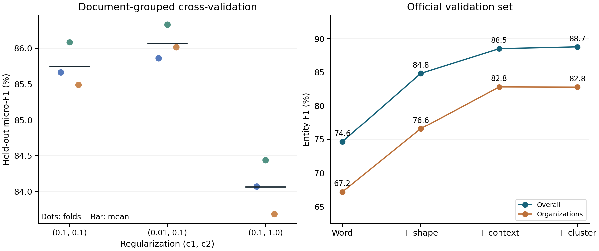
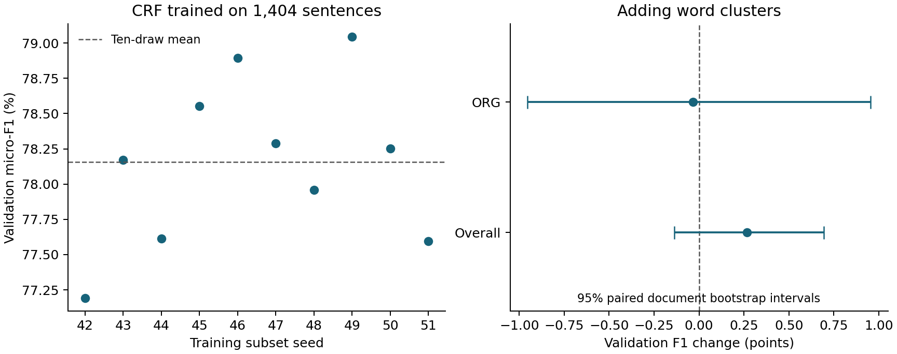

# CRF baseline and comparison with BERT on English CoNLL-2003

On the 3,453-sentence test set, BERT exceeded the linear-chain CRF by **10.52 micro-F1 points** with full training data and **13.54 points** with the same 10% training subset. The largest full-data gain by entity type was for organizations. All four results use the same 5,648 annotated test entities.

## Experimental method

The CRF used lowercase words, casing and digit indicators, hyphens, two- and three-character prefixes and suffixes, features from the previous and next word, and sentence-boundary indicators. We trained with L-BFGS for up to 80 iterations. Among three pairs of L1 and L2 coefficients, both training conditions selected c1 = 0.01 and c2 = 0.1 on the 3,250-sentence validation set. Validation micro-F1 was 88.48% for full training and 77.19% for 10% training.

The full condition used 14,041 training sentences. The shared 10% condition used 1,404 sentences sampled without replacement with seed 42. The CRF training record, A’s shared ID file and C’s BERT training manifest identify the same subset. The three Parquet file hashes also match. All four prediction files cover each test ID exactly once and have one tag per original token. C’s files store IDs and tags, so the original words for the paired analysis were recovered from the matching test data.

A prediction counts as correct when its start, end and entity type match the reference in the same sentence. An I-X following a different type or an outside tag, or appearing at the start of a sentence, opens a new X entity. We reproduced all four micro-F1 scores with the team evaluator and checked them against strict IOB2 scoring after this normalization. [CoNLL-2003 shared task](https://aclanthology.org/W03-0419/) · [Team repository snapshot](https://github.com/tzhang2357-del/5489ner/tree/f80761d3463e9c1f95360b8a3be0dead3b21a3f8)

## Overall results and data efficiency

| Experiment | Model | Training sentences | Precision | Recall | Micro-F1 | TP | FP | FN |
|---|---|---:|---:|---:|---:|---:|---:|---:|
| E1 | CRF | 14,041 | 81.75% | 79.57% | 80.65% | 4,494 | 1,003 | 1,154 |
| E2 | BERT | 14,041 | 90.32% | 92.03% | 91.17% | 5,198 | 557 | 450 |
| E3 | CRF | 1,404 | 74.55% | 68.66% | 71.48% | 3,878 | 1,324 | 1,770 |
| E4 | BERT | 1,404 | 83.89% | 86.19% | 85.02% | 4,868 | 935 | 780 |

Reducing the training set lowered CRF micro-F1 by 9.16 points and BERT micro-F1 by 6.15 points. These differences use unrounded scores. BERT retained more of its full-data performance on this sampled subset. The experiment compares two complete systems and uses one subset draw, so it cannot isolate pretraining as the cause or establish variability across draws.

## Entity type and length

| Test entity | Gold mentions | CRF full F1 | BERT full F1 | CRF 10% F1 | BERT 10% F1 |
|---|---:|---:|---:|---:|---:|
| PER | 1,617 | 84.18% | 96.13% | 75.54% | 94.59% |
| ORG | 1,661 | 73.69% | 89.31% | 63.06% | 80.90% |
| LOC | 1,668 | 86.08% | 93.34% | 77.06% | 87.71% |
| MISC | 702 | 75.11% | 79.48% | 67.58% | 66.57% |

With full data, BERT gained about 15.62 F1 points on ORG. At 10%, MISC was the one category where the CRF scored higher. Aggregating all entity types would hide that result.

| Gold span length | Mentions | Full CRF exact recall | Full BERT exact recall |
|---|---:|---:|---:|
| 1 word | 3,574 | 77.48% | 91.69% |
| 2 words | 1,776 | 85.02% | 93.19% |
| 3+ words | 298 | 72.15% | 89.26% |

For entities of three or more words, BERT recovered 266 of 298 and the CRF recovered 215. This 17.11-point recall gain measures correct boundaries **and** type. The error audit below examines boundary-only and type-only errors separately.

## What the models got wrong

| Full-test error events | CRF | BERT |
|---|---:|---:|
| Correct boundaries, wrong type | 551 | 226 |
| Incorrect boundaries, correct type | 168 | 83 |
| Incorrect boundaries and type | 85 | 57 |
| Unpaired missed gold entity | 350 | 84 |
| Unpaired spurious prediction | 199 | 191 |

Exact matches were removed first. Overlapping residual spans were paired one-to-one, prioritizing identical boundaries, then identical types, then other overlaps. Within each priority, the largest intersection over union was paired first. A paired error contributes one FP and one FN to strict scoring. The largest reductions in these diagnostic counts were in type errors (325 fewer) and unpaired misses (266 fewer).

The full models disagreed on 951 sentences. We sampled 20 of these with seed 42. The following six examples illustrate specific mentions from that sample. Counts in the preceding table cover the entire test set.

| Test ID | Gold mention | CRF | BERT | Observation |
|---|---|---|---|---|
| 2164 | Munich Re · ORG | Munich Re · PER | Munich Re · ORG | Both found the full name. BERT assigned the company type. |
| 395 | ANAHEIM · ORG | Missed | ANAHEIM · ORG | The CRF missed the team in a fixture headline. |
| 951 | Zaklady Piwowarskie w Zywcu SA · ORG | Zaklady Piwowarskie · PER and Zywcu SA · PER | Complete gold span · ORG | The CRF split one organization into two person predictions. |
| 2564 | SKIING-WORLD CUP · MISC | Exact | NORDIC SKIING-WORLD CUP · MISC | BERT included the preceding adjective. |
| 146 | Udinese · ORG | Udinese · ORG | Udinese · MISC | The CRF assigned the annotated type. |
| 1430 | Buenos Aires, Quequen, Rosario, Bahia Blanca · four LOC mentions | One merged LOC | One merged ORG | Both missed the boundaries between adjacent place names. |

[Four-experiment figure](../results/final/four_experiments.png) · [All 20 paired cases](../results/paired/error_cases.csv) · [Recomputed metrics](../results/final/metrics.csv)

## Document-grouped cross-validation for CRF regularization

To assess whether the original regularization choice generalized across news articles, we recovered 946 document IDs by matching every training sentence, token for token, to the English training text with document boundaries. Three GroupKFold splits held out 314, 316 and 316 whole documents (4,679, 4,681 and 4,681 sentences). Each candidate used the same full CRF feature set and folds. Every training sentence was held out once. [Document boundary source](https://github.com/patverga/torch-ner-nlp-from-scratch/blob/master/data/conll2003/eng.train)

| L1 | L2 | Fold 1 F1 | Fold 2 F1 | Fold 3 F1 | Mean F1 | Sample SD (points) |
|---:|---:|---:|---:|---:|---:|---:|
| 0.1 | 0.1 | 85.66% | 86.09% | 85.49% | 85.75% | 0.31 |
| **0.01** | **0.1** | **85.86%** | **86.33%** | **86.02%** | **86.07%** | **0.24** |
| 0.1 | 1.0 | 84.07% | 84.43% | 83.68% | 84.06% | 0.38 |

The highest mean identified the same pair as the original validation sweep. It also ranked first in each fold. We refit on all 14,041 training sentences with this pair for each feature comparison below. The grouped-CV mean measures performance when fitting on two folds. The ablation scores measure performance after fitting on the full training split.

## Feature ablation and unsupervised word clusters

Organizations accounted for 780 of the training entities with at least three words, compared with 76 locations of that length. This motivated tracking ORG F1 alongside the overall score. We compared cumulative feature sets on the same 3,250 official validation sentences, holding the optimizer, regularization and iteration limit fixed. [Training entity length distribution](../results/extensions/training_entity_lengths.png)

| Feature set | Official validation micro-F1 | ORG F1 |
|---|---:|---:|
| A. Lowercased word and bias | 74.64% | 67.20% |
| B. A plus word shape and affixes | 84.81% | 76.59% |
| C. B plus adjacent words, their shape and sentence boundaries | 88.48% | 82.81% |
| D. C plus the current word's cluster ID | 88.74% | 82.78% |

Adding local context and boundary indicators increased overall F1 by 3.66 points and ORG F1 by 6.22 points, computed before rounding. On validation sentence 33, B extracted only “County Cricket Board”. C recovered the full annotated organization “Test and County Cricket Board”. The comparison measures the combined feature additions at each step.

We tested whether words occurring in similar contexts could share a feature even when their spellings differed. Using training text alone, we counted directional immediate neighbors for each lowercased word occurring at least three times. We used sublinear TF-IDF, reduced the matrix to 32 dimensions with truncated SVD, normalized the vectors, and ran 32-cluster k-means with 10 initializations and seed 42. The 7,516 clustered word types covered 87.07% of validation token occurrences. All other words received an unknown-cluster feature. Cluster IDs are categorical features; entity labels were used only for supervised CRF training and evaluation.

| Cluster | Words | Examples nearest the centroid |
|---|---:|---|
| 5 | 191 | herve, don, ricardo, alain, herschelle |
| 8 | 278 | conference, tournament, match, morning, later |
| 12 | 296 | confirm, reach, protect, ease, choose |

Clusters captured recurring grammatical contexts, with some groups mixing several meanings. Adding them yielded a small 0.27-point overall validation gain and a 0.03-point decline for ORG. The larger gain came from adding neighboring-word and sentence-boundary features. These comparisons use a single official validation split. The four main test results above still refer to the original CRF and BERT systems.

## CRF sensitivity to the choice of 10% training sample

We trained the context-feature CRF on ten sentence samples of 1,404 training sentences each, using consecutive seeds 42–51. Each draw sampled without replacement from the 14,041 training sentences. All runs used the same previously selected regularization, features and official validation set. Seed 42 exactly reproduced the shared subset IDs and the original validation micro-F1 of 77.19%.

Across ten draws, validation micro-F1 averaged **78.16%**, with a sample standard deviation of **0.59 points** and a range of **77.19–79.05%**. The team's seed-42 draw was the lowest of these ten. The full-data CRF achieved 88.48% on the same validation set, 10.32 points above the ten-draw mean. The 0.59-point SD describes variation across training samples with this fixed validation set. The multi-draw experiment covered the CRF only. The paired CRF–BERT comparison on the test set uses the original shared draw.

## How consistently did word clusters help?

We refit both the context CRF (C) and context-plus-cluster CRF (D) on each of the original document-grouped training folds. Each fold learned its vocabulary, TF-IDF weights, SVD projection and 32 clusters exclusively from the articles available for fitting in that fold. Both models used the previously selected regularization. This is a paired sensitivity check on the tuning folds.

| Held-out document fold | C micro-F1 | D micro-F1 | D minus C (points) |
|---|---:|---:|---:|
| 1 | 85.86% | 86.13% | +0.27 |
| 2 | 86.33% | 86.43% | +0.09 |
| 3 | 86.02% | 86.20% | +0.18 |

The mean paired improvement was **0.18 points**. Separately, on the 3,250 official validation sentences, we held the fitted models fixed and resampled all 216 validation articles with replacement 10,000 times (seed 42). Each resample used the same articles for C and D and recomputed F1 from their pooled entity counts. The observed micro-F1 gain was **0.27 points**, with a paired percentile 95% interval of **−0.14 to +0.69**. For ORG, the change was **−0.03 points** with an interval of **−0.96 to +0.96**. All three training folds favored D slightly; the official validation data remain compatible with small gains or losses. These intervals describe validation-article sampling, conditional on the fitted models.

[Per-seed results](../results/robustness/subset_scores.csv) · [Paired fold results](../results/robustness/paired_folds.csv) · [Document intervals](../results/robustness/paired_document_intervals.csv)
