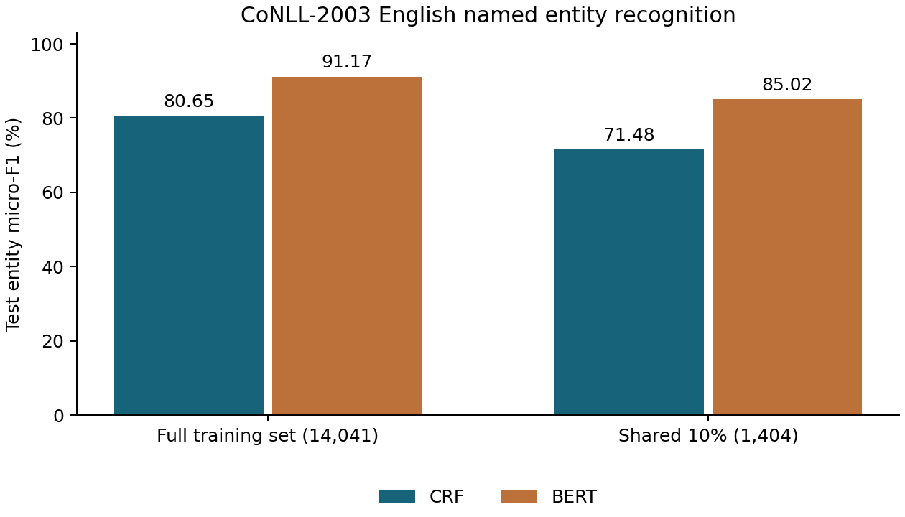

# BERT for English named entity recognition under two training budgets

Fine-tuning BERT on all 14,041 training sentences (E2) yielded **91.17% test micro-F1**. The second BERT run (E4) scored **85.02%** on the same test set after training on the 1,404 sentences shared with the low-data CRF. The 6.15-point drop was uneven. Person names remained relatively stable, while the largest F1 loss was in MISC.

## From subwords to named entities

We fine-tuned the cased `bert-base-cased` encoder and a token classification head jointly. Each original CoNLL word received one of nine labels, comprising B and I for each of PER, ORG, LOC and MISC, plus O for words outside an entity. A fast WordPiece tokenizer retained the index of the original word for every subword. We computed cross-entropy at the first subword of each word and ignored subsequent subwords, special tokens and padding. At inference, the label with the highest score at that same first subword became the word's prediction.

Test sentence 951 illustrates why the mapping matters. The five words in `Zaklady Piwowarskie w Zywcu SA` occupy 15 subword positions. The second word, `Piwowarskie`, becomes `Pi`, `##wo`, `##war`, `##ski`, `##e`. Only `Pi` supplies the label for that word. E2 recovered the five word labels `B-ORG I-ORG I-ORG I-ORG I-ORG`, producing one organization mention. [Paired case records](../results/paired/error_cases.csv)

The notebook splits long sentences at word boundaries into chunks of at most 128 tokens including `[CLS]` and `[SEP]`. It pads each batch to its longest chunk and rejoins word predictions in sentence order before decoding entities. It checks that every original word has exactly one prediction. In the shared decoder, an `I-X` with no open entity of type X begins a new entity. Scoring requires an exact match on sentence, word boundaries and type. [Training and inference notebook](../src/train_bert.ipynb)

## Training and checkpoint selection

E2 and E4 each started from the same pretrained checkpoint. E4 used the exact training IDs used by E3, the 10% CRF. Both BERT runs used seed 42, the full 3,250-sentence validation split and the same 3,453-sentence test split. We trained for three epochs on one Tesla T4 with FP16 mixed precision and batches of 16 chunks. AdamW used a peak learning rate of 0.00003, weight decay of 0.01 and a gradient norm limit of 1.0. The learning rate warmed up over the first 10% of planned updates and then decayed linearly. [Shared training IDs](../data/train_10pct_ids.shared.json) · [Model and data revisions](../results/final/bert_manifest.json)

| Validation micro-F1 | Epoch 1 | Epoch 2 | Epoch 3 | Recorded run time |
|---|---:|---:|---:|---:|
| E2 · full data | 93.92% | 94.52% | **95.03%** | 259 s |
| E4 · shared 10% | 75.71% | 85.06% | **86.86%** | 43 s |

We selected each checkpoint by its highest validation entity micro-F1. Both runs selected epoch 3. We then reloaded the selected weights to produce the test predictions below.

## Test results and data efficiency

| Experiment | Precision | Recall | Micro-F1 | Correct entities | False positives | False negatives |
|---|---:|---:|---:|---:|---:|---:|
| E2 · full data | 90.32% | 92.03% | **91.17%** | 5,198 | 557 | 450 |
| E4 · shared 10% | 83.89% | 86.19% | **85.02%** | 4,868 | 935 | 780 |

With full training data, BERT exceeded the CRF by 10.52 F1 points. With the shared 10% subset, the gap was 13.54 points. BERT lost 6.15 points as training data decreased, compared with 9.16 for the CRF. These differences use unrounded scores. Two aspects of the design limit the interpretation. The BERT runs used one shared subset and one seed. Also, fixing training at three epochs gave E2 2,634 training batches and E4 264, so the comparison reflects both a change in labeled examples and a change in the number of updates available. [Four-experiment scores](../results/final/metrics.csv)

### Which mentions did the full-data run recover?

For each gold mention, we compared the two saved predictions on the same sentence. A model recovered the mention only when its predicted span and type both matched. The last four columns partition all 5,648 gold mentions. Spurious predictions have no corresponding gold mention and contribute separately to precision.

| Gold type | E2 F1 | E4 F1 | Both correct | E2 only | E4 only | Neither correct |
|---|---:|---:|---:|---:|---:|---:|
| PER | 96.13% | 94.59% | 1,518 | 35 | 13 | 51 |
| ORG | 89.31% | 80.90% | 1,328 | 184 | 32 | 117 |
| LOC | 93.34% | 87.71% | 1,480 | 76 | 22 | 90 |
| MISC | 79.48% | 66.57% | 457 | 120 | 18 | 107 |
| **All types** | **91.17%** | **85.02%** | **4,783** | **415** | **85** | **365** |

E2 recovered 330 more gold mentions overall. ORG accounted for 152 of that net gain and MISC for 102, together **254 of 330 (77.0%)**. MISC had the largest F1 drop under the smaller training budget (12.90 points), while PER dropped 1.54 points. The 85 mentions correct only in E4 also show that a higher overall score need not improve every sentence. [Per-type scores](../results/metrics_by_type_bert.csv) · [E2 predictions](../results/predictions/e2_bert_full_test.jsonl) · [E4 predictions](../results/predictions/e4_bert_10pct_test.jsonl)

Length mattered most for mentions of **three or more original words**. E2 recovered 266 of 298 (89.26%), and E4 recovered 222 (74.50%). The 14.77-point gap was larger than the gaps for one-word and two-word mentions (5.09 and 5.86 points). These are exact-match recall measures, so either a boundary mistake or a wrong type counts as a miss. [Recall by entity length](../results/recall_by_length_bert.csv)

### Three test cases

| Test ID | Gold mention | E2 · full | E4 · 10% |
|---|---|---|---|
| 951 | `Zaklady Piwowarskie w Zywcu SA` · ORG | One ORG with both boundaries correct | Split into `Zaklady Piwowarskie w` and `Zywcu SA` |
| 877 | `Nicol` · PER | ORG | PER |
| 2564 | `SKIING-WORLD CUP` · MISC | Extended left to include `NORDIC` | Extended right to include `BIATHLON` |

In sentence 951, E4 retained the correct type but split the organization at an internal word boundary. The full CRF split the same gold mention into two person predictions. Sentence 877 illustrates a gain in the low-data run. Both BERT runs found the name, but only E4 assigned the correct type. In sentence 2564, the full CRF recovered the exact mention while the two BERT runs extended it in opposite directions. These cases distinguish entity segmentation from type assignment and illustrate the limits of attributing an individual decision to training-set size. [CRF comparison and case selection](role_b.md#what-the-models-got-wrong)

## Model downloads and reproduction

- **For inference**, download the selected checkpoint, then unzip it into its own directory. Each archive includes the fine-tuned weights, label map and matching tokenizer. E2 is the full-data model used for the project demo. [E2 model](https://github.com/tzhang2357-del/5489ner/releases/download/bert-v1/E2_best_model.zip) · [E4 model](https://github.com/tzhang2357-del/5489ner/releases/download/bert-v1/E4_best_model.zip)
- **To reproduce training**, open the notebook in Colab Enterprise on a GPU runtime. After the configuration cell prints `SHARED_IDS`, copy the repository's `data/train_10pct_ids.shared.json` to that location (by default, `ner_c_work/data/train_10pct_ids.json`). Run the remaining cells in order to train both conditions, reload the winning checkpoints, score the test predictions and export the results. The recorded environment used PyTorch 2.11.0+cu128 and Transformers 4.57.6. [Notebook](../src/train_bert.ipynb) · [Shared 10% IDs](../data/train_10pct_ids.shared.json)
- **To verify the results**, join the saved word-level predictions to the pinned CoNLL-2003 test split by sentence ID. Each experiment contains 3,453 sentences and 46,435 word labels. For the paired table above, decode the gold and both predicted sequences, then count each gold span according to its membership in the E2 and E4 span sets. [Dataset and file hashes](../results/final/bert_manifest.json) · [Recomputed test scores](../results/final/four_scores.json)
